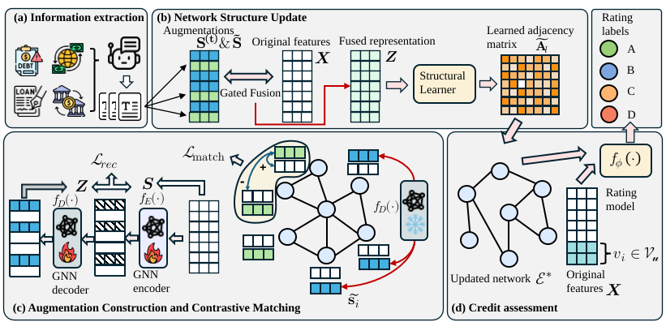

# GLAG

This repository contains the source codes of the GLAG and the interbank credit rating assessment dataset. 

Paper: [Generative LLM-Augmented Graph Mining for Interbank Credit Assessment]()

Author(s): *Anonymous Submission*



## Requirements

We recommend using Python≥3.10 to run the experiments.

The dependency list exported via pip is provided in the repository. You can install all required packages by running:

```
pip install -r requirements.txt
```

## Experiments
You can run the quarterly interbank credit rating assessment experiment using the following command:
```
python main.py --device=0 --gnn_type='GT' --input_dim=70 --hid_dim=256 --pretrain_epochs=1000 --rec_mat_epochs=200 --tune_epochs=100 --shot_num=100 --lr=0.01 --weight_decay=5e-4
```

With this configuration, the model predictions will first be saved in the `preds/`. Afterward, the final evaluation results can be generated by running:
```
python preds_to_table.py
```
The processed results will be stored in the `results/`.

To conduct parameter sensitivity analysis, you can specify different experimental settings using the `--exp` argument. For example:
```
--exp=temperature
--exp=epsilon
--exp=smooth
```
You can then modify the corresponding parameter values to evaluate the impact of different configurations.

## Dataset
The interbank dataset used in our experiments is provided in the `datasets/`:
* `nodes/` contains the network nodes of banks and related entities.
* `edges/` contains the interbank lending network connections.

The supplementary textual data is saved at `summary/`. The language model used for encoding the textual data should be stored in the `embedding_models/`. The mapping between bank names and node indices is stored in `idx_ticker_mapping.json`.

## Supplementary materials

See [appendix/README.md](appendix/README.md) for supplementary financial examples, experimental settings, baseline configurations, and generation prompts.

## LICENSE

This project is licensed under the MIT License - see the LICENSE file for details.
